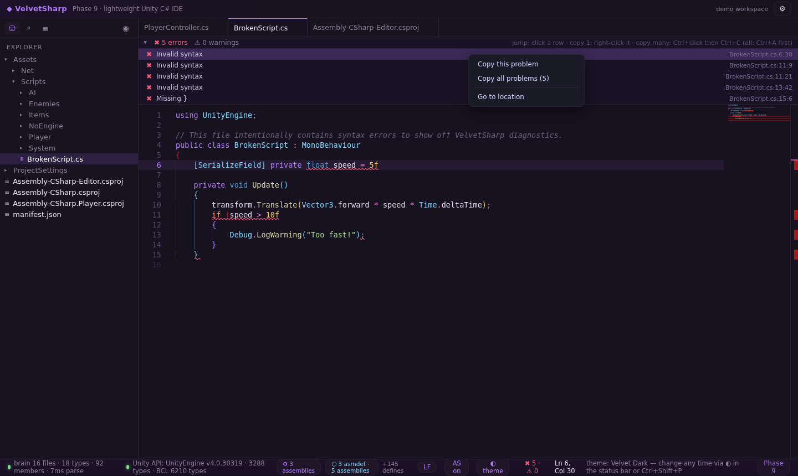

# ◆ VelvetSharp

**A lightweight, fast-opening Unity C# IDE — a portable alternative to Rider, Visual Studio and VS Code.**

*Phase 9 · build 9.0.0 — the phase is always visible in the status bar; every release bumps it by one (see [VERSIONS.md](VERSIONS.md)).*

Zero .NET runtime. Zero OmniSharp. Zero Electron. The entire C# intelligence engine ("the brain") is custom-built in TypeScript, runs off the UI thread in a Web Worker, on tree-sitter (WASM) + a Unity API database extracted straight from `UnityEngine.dll` by our own ECMA-335 metadata reader. The desktop shell is Neutralino 6.x — the whole portable build is a **6 MB zip** that opens a Unity project in seconds.

| Editor | Call Flow |
|---|---|
|  |  |

---

## Why

Unity scripts are small, but the IDEs people use for them are not. VelvetSharp starts in milliseconds, ships as a single folder, and still gives you the parts that actually matter when writing gameplay code: real completions, real diagnostics, project-wide rename, and now **per-script call flow** — a generated flowchart of how one script's methods travel.

## Features

### C# brain (custom engine — no .NET SDK)
- **Completions** with local type inference (`var` + `GetComponent<T>()`), cross-class and whole-file awareness — a method declared at the bottom of the file shows up at the top, in every class of the project, after `instance.`, `this.` and bare
- **Unity magic methods** — Awake / Start / Update / FixedUpdate / OnCollisionEnter… are synthesized onto MonoBehaviour (34 lifecycle messages with docs), so they always complete
- **Diagnostics** — syntax squiggles, unreachable code, obsolete references, duplicate types, missing usings (with one-click `using` fixes), out/ref argument checking, csproj-driven assembly + define awareness. Phase 9 killed the false-positive class: members of known types (`Array.Empty<int>()`) are never "missing", and ambiguous-reference noise is suppressed
- **Hover docs + signature help** straight from `UnityEngine.xml` and the extracted BCL/Unity databases
- **Go-to-definition (F12) + find-all-references (Shift+F12)** — select any symbol and a Problems-style panel lists every use *and where it comes from* (`field Player.jumpForce — PlayerController.cs:12 · Assembly-CSharp`), click to jump
- **Project-wide rename (F2)** — every reference in every file, meta files included

### Graphs
- **⬡ Dependency graph** — project types only (classes / structs / interfaces / enums, no symbol dump), 4 layouts (hierarchical, organic, circular, business), folder scoping, optional Unity/BCL externals. **Phase 9: singletons** — `static OwnType Instance` fields get a badge and a self-loop, "ones that link something to itself"
- **⚡ Call Flow (new in Phase 9)** — pick any script and see how its methods call each other. Calls that leave the script (`Debug.Log`, other classes, the Unity API) are drawn as **dashed capsules that terminate the branch** — the shape tells you where your code ends and the outside world begins. Unity event methods carry a **U** badge; methods nothing calls in-script are highlighted as entries


### Workspace
- Explorer with Unity semantics (`.meta` handling, asmdef badges, folder context menu), search across files, outline, quick open (Ctrl+P), symbol search (Ctrl+T), commands (Ctrl+Shift+P)
- **Problems bar** sweeping every script in the project — click to jump, Ctrl+click multi-select, and since Phase 9 **right-click → *Copy this problem*** copies exactly one diagnostic



### Shell
- Neutralino 6.x desktop shell (WebView2 on Windows) — ~2 MB runtime, no installer needed
- Multiple velvet themes (Tokyo Night, Velvet Dark, …) that persist across restarts, font size, word wrap, auto-save, line-ending awareness (LF/CRLF per document)
- Self-healing native bridge: timeouts, auto-reconnect, token recovery, health chip — if the desktop API hiccups, the app recovers instead of dying
- Global error popup with copyable stack traces, disk-backed settings (`%APPDATA%/VelvetSharp/config.json`)

## Getting started

### Portable (Windows)
1. Grab `VelvetSharp-vX.Y.Z-win-x64-portable.zip` from the [latest release](https://github.com/CodyDream/VelvetSharp/releases/latest)
2. Unzip anywhere — **no installer, no admin, no .NET**
3. Run `VelvetSharp.exe`, open your Unity project folder (or drag it in), done

### Run from source (any OS with Node 18+)
```bash
npm install
npm install --prefix app
npm run dev          # vite dev server on :5173
```
Browser demo mode opens with the bundled demo workspace; the native desktop shell needs the Neutralino binaries (see [BUILD-WINDOWS.md](BUILD-WINDOWS.md)).

### Build the Windows portable zip
```bash
npm run build                                # vite build
rsync -a --delete app/dist/ desktop/app/dist # resources root
cd desktop && npx neu build --release        # resources.neu + binaries
# dist/VelvetSharp/VelvetSharp-win_x64.exe + resources.neu + README-FIRST.txt → zip
```
Or just **push a `v*` tag** — GitHub Actions builds and publishes the release zip automatically (see `.github/workflows/release.yml`); CI runs the full engine test suite on every push.

## Repository layout

```
app/                  React + Monaco UI (vite)
  src/                editor, explorer, graphs, themes, workers, store
  public/api/         UnityEngine + BCL databases (extracted from DLLs)
  public/demo/        bundled demo Unity project
  demo/               the same demo workspace, used by the engine tests
packages/brain/       the C# engine: parser, index, completions, diagnostics,
                      rename, uses, dependency graph, call flow (Web Worker)
packages/metadata/    ECMA-335 / PE reader + DocXML parser (builds the API DBs)
desktop/              Neutralino 6.x shell (config + binaries)
docs/screenshots/     images used by this README
scripts/              tests, verify markers, build helpers
```

## Testing

```bash
npm test          # engine suite (131 assertions across 7 suites) + dist markers
npm run test:brain
```

The engine suite covers parsing, symbol extraction, type inference, completions, hover, diagnostics, rename, uses, the dependency graph (types-only + singleton self-loops) and the call-flow graph (in-file edges, external terminals, Unity lifecycle flags). Visual E2E (Playwright + Chromium) clicks through the real UI — 34 assertions including the Phase 9 copy menu and call-flow rendering.

## Phase history

| Phase | Build | Highlights |
|---|---|---|
| 1–4 | 0.1–0.4 | editor, syntax lints, project open, packaging |
| 5 | 0.5.0 | semantic analysis, problems bar, project rename |
| 6 | 0.6.0 | dependency graph, explorer file ops, F2 everywhere |
| 7 | 7.0.0 | phase numbering, self-healing bridge, settings persistence |
| 8 | 8.0.0 | types-only graph, whole-file completions, Unity magic methods, uses panel |
| **9** | **9.0.0** | **false-positive fixes (Array.Empty / CS0104), right-click copy problem, singleton self-loops, per-script Call Flow view** |

Full details in [VERSIONS.md](VERSIONS.md).

## License

MIT — see [LICENSE](LICENSE).
