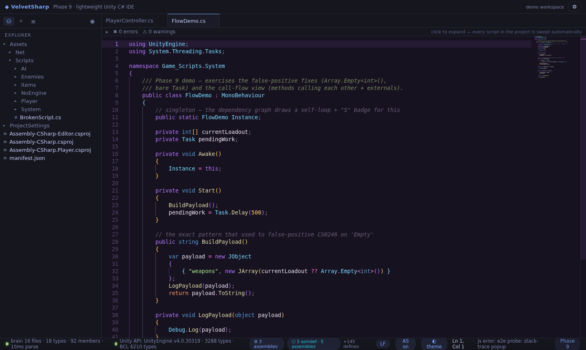
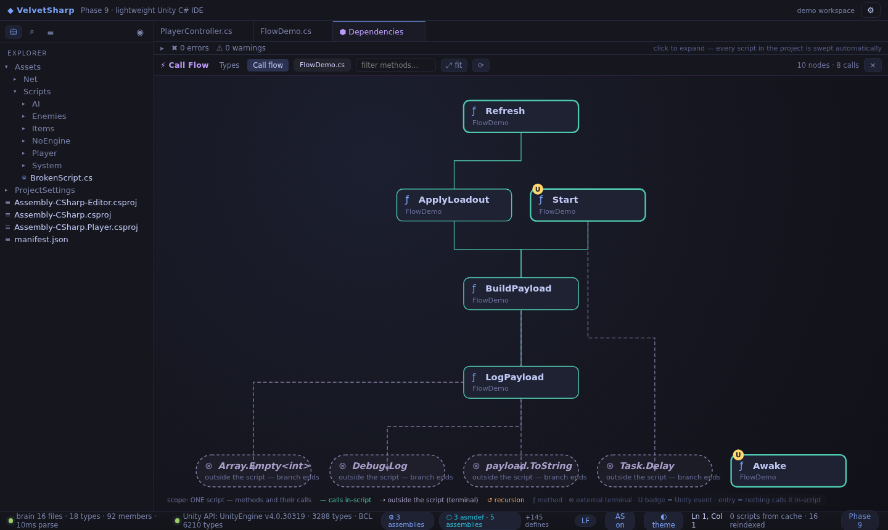
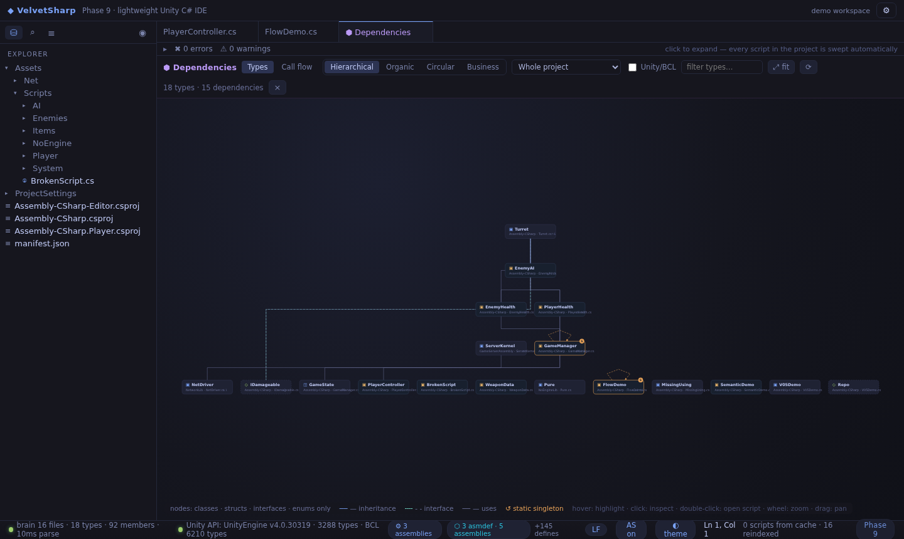

# ◆ VelvetSharp

**A lightweight, fast-opening Unity C# IDE — a portable alternative to Rider, Visual Studio and VS Code.**

*Phase 14 · build 14.0.0 — the phase is always visible in the status bar; every release bumps it by one (see [VERSIONS.md](VERSIONS.md)).*

Zero .NET runtime. Zero OmniSharp. Zero Electron. The entire C# intelligence engine ("the brain") is custom-built in TypeScript, runs off the UI thread in **two Web Workers** (an interactive lane + an analysis lane), on tree-sitter (WASM) + a Unity API database extracted straight from `UnityEngine.dll` by our own ECMA-335 metadata reader. The desktop shell is Neutralino 6.x — the whole portable build opens a Unity project in seconds.

| Editor | Call Flow |
|---|---|
|  |  |

---

## Why

Unity scripts are small, but the IDEs people use for them are not. VelvetSharp starts in milliseconds, ships as a single folder, and still gives you the parts that actually matter when writing gameplay code: real completions, real diagnostics, project-wide rename, navigation history, and a **per-script call flow** that reads like a flowchart of your own code.

## Features

### C# brain (custom engine — no .NET SDK)
- **Completions that never miss** — two-lane brain: interactive RPCs answer on a dedicated fast worker fed light per-keystroke updates, while deep analysis runs on a second worker, so a completion can never queue behind a full-file re-analysis. Instant same-file floor, prefix-chain cache (a `tr` answer serves `trans`), guarded in-place late upgrades, member access bounded at 300 ms with last-good fallback — and word-based "grammar suggestions" are off, so the widget never degrades to document-noise
- **Cross-class and whole-file awareness** — a method declared at the bottom of the file shows up at the top, in every class of the project, after `instance.`, `this.` and bare
- **Unity magic methods** — Awake / Start / Update / FixedUpdate / OnCollisionEnter… are synthesized onto MonoBehaviour (34 lifecycle messages with docs), so they always complete
- **Diagnostics** — syntax squiggles, unreachable code, obsolete references, duplicate types, missing usings (with one-click `using` fixes), out/ref argument checking, csproj-driven assembly + define awareness, and the Phase 9 false-positive kills (`Array.Empty<int>()` is never "missing", ambiguous-reference noise suppressed)
- **Preprocessor directives are first-class (Phase 11)** — Unity's full define set + `UNITY_<year>_<minor>_OR_NEWER` chain from ProjectVersion.txt + your custom `scriptingDefineSymbols`; inactive `#if` branches are dimmed and silent, `#pragma warning disable` honored, `#error`/`#warning` surfaced, stray directives diagnosed
- **Hover docs + signature help** straight from `UnityEngine.xml` and the extracted BCL/Unity databases
- **Go-to-definition (F12) + find-all-references (Shift+F12)** — a Problems-style panel lists every use *and where it comes from*, click to jump; navigation history (Alt+Left/Right) remembers every jump
- **Project-wide rename (F2)** — every reference in every file, meta files included

### Graphs
- **⬡ Dependency graph** — project types only (classes / structs / interfaces / enums), 4 layouts (hierarchical, organic, circular, business), folder scoping, optional Unity/BCL externals, static-singleton badges with self-loops
- **⚡ Call Flow** — pick any script and see how its methods travel, rebuilt in Phase 13 to show **only your custom methods**:
  - **Engine/API calls are not drawn** — `Debug.Log`, `GetComponent`, `Mathf`… are distractions; the toolbar chip counts what was hidden (`N engine/API hidden`)
  - **Cross-file custom methods still appear** — `GameManager.Spawn()` or a typed-field call like `player.Heal()` resolve to dashed terminals carrying their defining script (double-click opens it); the branch ends there
  - **Call-order badges** — every method's outgoing calls are numbered **1·2·3** in the order they appear (and execute) in that method's body, localized per method, echoed in the details panel
  - **Boxes size themselves** — each node grows to fit its full name, in every layout
  - **Vertical tidy-tree flowchart** (Phase 10) — sources on top, calls flow down, every branch owns its column; connectivity-ranked selection keeps the connected core of huge scripts
  - Unity event methods carry a **U** badge; methods nothing calls in-script are highlighted as entries



### Workspace
- Explorer with Unity semantics (`.meta` handling, asmdef badges, folder context menu), outline, quick open (Ctrl+P), symbol search (Ctrl+T), commands (Ctrl+Shift+P)
- **Find in project files (Ctrl+Shift+F)** — live debounced search across every script with case / whole-word / regex toggles, per-file grouping with counts, the matched span highlighted in its line context, Enter jumps to the first hit — and an honest coverage report: files the warm-start cache hasn't loaded yet show up as *“N files not scanned yet — scan & re-run”* instead of being silently missing
- **Problems bar** sweeping every script in the project — click to jump, Ctrl+click multi-select, right-click → *Copy this problem*
- **Editor right-click → Collapse ▸** — by Methods / by #Regions / by #if Blocks / XML Doc Comments / All / Expand; **/// + Enter** generates the XML documentation skeleton

### AI agents (MCP)
- **Built-in Model Context Protocol server** (`mcp/server.mjs`, zero dependencies) — Claude Desktop, Claude Code, Cursor, Cline or any MCP client can ask the **running editor** what it sees and then fix things with their own tools:
  - `get_problems` — every syntax error / warning the Problems bar shows (including unsaved buffers), compiler-style rows with codes (`File(line,col): ERROR CS1002: …`)
  - `get_project_structure` — the workspace file tree (optionally scoped to a folder)
  - `search_code` — the same find-in-files engine as Ctrl+Shift+F (literal / whole-word / regex)
  - `get_file` — file content or a line range; returns the **live editor buffer** when the file is open with unsaved changes
  - `get_workspace_summary` — root, file counts, error/warning totals, assemblies — the agent's first call
- Connection is automatic: the editor publishes `{port, root, token}` to `<dataDir>/VelvetSharp/mcp.json`; point the agent at `mcp/server.mjs` (needs Node 18+) — see [mcp/README.md](mcp/README.md). Everything stays on `127.0.0.1`

### Shell
- Neutralino 6.x desktop shell (WebView2 on Windows) — ~2 MB runtime, no installer needed
- **Rock-solid connection** — two-lane workers that reject dead calls deterministically, respawn and re-sync from disk without a reload; the native bridge replays in-flight calls after a socket drop, heartbeats when idle, reconnects on Windows wake / network regain, and resets its zombie-socket counter on every success
- Multiple velvet themes (Tokyo Night, Velvet Dark, …) that persist across restarts, font size, word wrap, auto-save, line-ending awareness (LF/CRLF per document)
- **Errors are never silent** — a global error popup with copyable stack traces, copyable graph errors (version + mode + script + message + stack), and render-crash containment that keeps the app alive instead of white-screening
- Disk-backed settings (`%APPDATA%/VelvetSharp/config.json`)

## Getting started

### Portable (Windows)
1. Grab `VelvetSharp-vX.Y.Z-win-x64-portable.zip` from the [latest release](https://github.com/CodyDream/VelvetSharp/releases/latest)
2. Unzip anywhere — **no installer, no admin, no .NET**
3. Run `VelvetSharp.exe`, open your Unity project folder (or drag it in), done

### Run from source (any OS with Node 18+)
```bash
npm install
npm install --prefix app
npm run dev          # vite dev server on :5173
```
Browser demo mode opens with the bundled demo workspace; the native desktop shell needs the Neutralino binaries (see [BUILD-WINDOWS.md](BUILD-WINDOWS.md)).

### Build the Windows portable zip
```bash
npm run build                                # vite build
rsync -a --delete app/dist/ desktop/app/dist # resources root
cd desktop && npx neu build --release        # resources.neu + binaries
# dist/VelvetSharp/VelvetSharp-win_x64.exe + resources.neu + README-FIRST.txt → zip
```
Or just **push a `v*` tag** — GitHub Actions builds and publishes the release zip automatically (see `.github/workflows/release.yml`); CI runs the full engine test suite on every push.

## Repository layout

```
app/                  React + Monaco UI (vite)
  src/                editor, explorer, graphs, themes, two-lane workers, MCP dispatcher, store
  public/api/         UnityEngine + BCL databases (extracted from DLLs)
  public/demo/        bundled demo Unity project
  demo/               the same demo workspace, used by the engine tests
packages/brain/       the C# engine: parser, index, completions, diagnostics,
                      rename, uses, dependency graph, call flow (2 workers)
packages/metadata/    ECMA-335 / PE reader + DocXML parser (builds the API DBs)
desktop/              Neutralino 6.x shell (config + binaries)
mcp/                  MCP stdio server + agent setup guide (ships in the zip)
docs/screenshots/     images used by this README
scripts/              tests, probes, verify markers, E2E harnesses
```

## Testing

```bash
npm test          # engine suite (205 assertions across 13 suites) + dist markers (93)
npm run test:brain
```

The engine suite covers parsing, symbol extraction, type inference, completions, hover, diagnostics, rename, uses, the dependency graph (types-only + singleton self-loops), the call-flow graph (custom-methods-only + cross-file terminals + call-order ranks), snippets, preprocessor semantics, the two-lane light-update contract, the find-in-files options + coverage report and the MCP payload formatters. A dedicated crash-battery probe throws 16 C# torture fixtures (null-conditional, generics, lambdas, attributes, 400-method cycles, 900-call hubs…) at the engine and asserts zero throws plus structural invariants. Visual E2E (Playwright + Chromium) clicks through the real UI — completions, crash-recovery drills, the Phase 13 call-flow view and the Phase 14 find-in-files + MCP loop, which is exercised end-to-end against the REAL Neutralino server (browser page + stdio proxy + all five tools, `scripts/e2e-phase14.mjs`).

## Phase history

| Phase | Build | Highlights |
|---|---|---|
| 1–4 | 0.1–0.4 | editor, syntax lints, project open, packaging |
| 5 | 0.5.0 | semantic analysis, problems bar, project rename |
| 6 | 0.6.0 | dependency graph, explorer file ops, F2 everywhere |
| 7 | 7.0.0 | phase numbering, self-healing bridge, settings persistence |
| 8 | 8.0.0 | types-only graph, whole-file completions, Unity magic methods, uses panel |
| 9 | 9.0.0 | false-positive fixes, right-click copy problem, singleton self-loops, per-script Call Flow view |
| 10 | 10.0.0 | flow stability + ranked selection, vertical tidy-tree, instant completions, nav history |
| 11 | 11.0.0 | preprocessor directives first-class, Collapse ▸ submenu, /// XML doc generation |
| 11.1 | 11.1.0 | PR #1 merged — class-aware Singleton snippet + 8 Unity snippets |
| 12 | 12.0.0 | two-lane brain, worker crash recovery, the autocomplete range-bug root fix, bridge replay + heartbeat |
| 13 | 13.0.0 | call flow = only your custom methods (+ hidden-call chip), cross-file terminals, per-caller 1·2·3 call-order badges, self-sizing boxes, copyable graph errors + render-crash containment |
| **14** | **14.0.0** | **real find-in-files (Ctrl+Shift+F: live search, case/whole-word/regex, match highlighting, honest “not scanned yet → scan & re-run” coverage) + MCP server so AI agents can pull problems / structure / code search / file contents from the running editor** |

Full details in [VERSIONS.md](VERSIONS.md).

## License

MIT — see [LICENSE](LICENSE).
